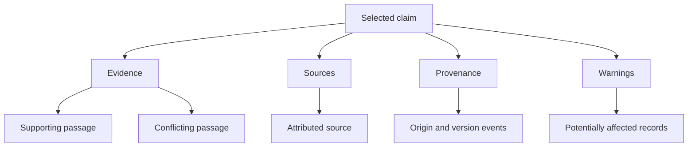

# ClaimTrail
## Product, experience and implementation specification

**Tagline:** Follow every claim back to its source.

**Version:** 1.0 — 13 October 2026

**Status:** Proposed product specification and hackathon build brief. Features below are requirements or recommendations, not claims about an existing implementation.

**Purpose:** Consolidate the project previously discussed as Sherlock.ai into ClaimTrail, incorporating the agreed file/URL entry point, a connected archive database, cross-document claim tracing, visual evidence branches and annotated exports.

---

## 1. The product in one paragraph

ClaimTrail is an AI-assisted information-management platform for investigating archival records. A user uploads a document or supplies the URL of an accessible archive record. ClaimTrail reads the content, extracts checkable claims, identifies available source and provenance details, and searches a connected collection for relevant evidence. It displays those relationships as an interactive network of branches. When a claim is disputed or corrected, ClaimTrail finds other records that may repeat it and opens each match at the exact highlighted passage. Every finding links back to evidence, and review decisions are recorded without changing the original record.

## 2. Decisions already agreed

| Area | Product decision |
| --- | --- |
| Name | ClaimTrail replaces Sherlock.ai as the product name. |
| Starting point | One file or one archive webpage URL. |
| Comparison collection | An existing connected repository, indexed into ClaimTrail; users should not need to upload 100 documents for each investigation. |
| Additional records | New records can be added individually or synchronised through an authorised connector. |
| Main findings | Claims, evidence, sources, provenance, warnings and potentially affected records. |
| Cross-document tracing | Locate the same underlying claim even when it has been paraphrased. |
| Flag location | Highlight a specific passage inside each matching document. |
| Visual signature | Organic, nerve-like branches that lead to expandable rectangular information cards. |
| Interaction | Hover previews; click or keyboard activation opens and pins details. Touch uses taps. |
| Output | Interactive investigation view plus an exportable annotated PDF report. |
| Automation ambition | Take over repetitive discovery, extraction, comparison and documentation work associated with information management. |
| Judgement | Keep proposed findings separate from reviewed decisions. Do not present unresolved conflicts as established misinformation. |

## 3. The problem ClaimTrail addresses

A record can repeat a figure, quotation or policy from another record. That statement may later be corrected, superseded or challenged, while copies of the earlier claim remain scattered across the collection. Searching for an exact phrase can miss paraphrases. Reading each file manually is slow, particularly when the documents are scans.

ClaimTrail should answer six practical questions:

1. What exactly does this record claim?
2. Who made that claim, when, and in what context?
3. What evidence supports or challenges it?
4. What can we establish about its origin and transmission?
5. Which other accessible records repeat or depend on it?
6. What needs human review, and what has already been decided?

The central demonstration is propagation: one reviewed correction reveals potentially affected passages across multiple documents.

## 4. Intended users and scope of automation

Primary users are information managers, records officers, archivists and researchers working with a defined collection. A public research mode can be developed later using only material that is publicly accessible and permitted for the intended use.

ClaimTrail should automate:

- Document intake, text extraction and initial metadata suggestions.
- Candidate claim extraction with original quotations and locations.
- Retrieval of relevant records from the authorised collection.
- Suggested relationships between claims.
- Discovery of repeated or paraphrased claims across files.
- Evidence assembly, visual presentation and report preparation.
- Creation of an audit history for system actions and user decisions.

The ambition is substantial workflow automation. A complete information-manager replacement is not a supported product promise: access decisions, historical interpretation, ambiguous evidence, records disposition and organisational accountability extend beyond this project's initial scope. Do not invent an automation percentage or time-saving result before measuring it.

## 5. What NAA context means for this product

The National Archives of Australia is the motivating archive context, not a confirmed integration partner. RecordSearch is a catalogue that provides descriptions and, for selected records, online digital copies. A catalogue entry is not necessarily the full record.

For historical paper records, public copies can consist of scanned page images. Some viewers allow PDF export. A PDF may contain selectable text, scanned images, or both; the extension alone does not tell us whether OCR is needed. NAA's preservation standards distinguish TIFF masters from access copies, and specify single-page TIFFs for digitised paper files. Do not assume that internal preservation masters are publicly downloadable.

ClaimTrail must distinguish:

| Situation | Product behaviour |
| --- | --- |
| Full digital content is available | Retrieve permitted content and analyse it. |
| Only catalogue metadata is available | Show the description and source link; mark content as unavailable for analysis. |
| The record is not available digitally | Explain that a digital copy is needed; allow a later upload. |
| A record requires an access application or other permission | Show the access limitation and official route; do not bypass it. |
| A supplied URL opens a collection or search page | Ask the user to choose an individual record from the supported results. |
| An archive endpoint is temporarily unavailable | Retain the input and offer retry or file upload. |

Do not equate “not available online” with “stored as text.” Records may exist in physical or digital formats without a publicly viewable copy.

**Statistics note:** Earlier discussion calculated approximately 15% online copies and 85% without copies using figures on an NAA overview page. The same figures appear in an older factsheet, so they should not be presented as a verified current collection-wide statistic. They also do not measure image-versus-text formats or access-application requirements. No such percentage is needed for ClaimTrail's pitch.

## 6. Input and repository model

### 6.1 File input

Target formats are PDF, JPEG, PNG and TIFF. Add plain text, Markdown and DOCX as useful subsequent formats. Make supported formats visible before upload; reject unsupported files clearly. For the hackathon, prioritise text PDFs and a small, tested set of scanned PDFs/images.

Processing must distinguish native text from OCR-derived text. Extract existing text first when reliable. Use OCR for image pages or unusable text layers. Handwriting is a harder case: label recognition uncertainty and offer manual correction instead of silently producing confident claims.

Store the original bytes, extracted text, extraction method, page location and content hash separately. A correction to OCR text creates a new extraction revision; it must not rewrite the original image.

### 6.2 Webpage input

The user pastes an archive record URL. A supported connector resolves the record's metadata and accessible content. Present the resolved title, institution, record identifier and content availability before analysis.

A general URL extractor can support ordinary readable pages. A specialised archive viewer may require a separate connector, an approved API or an uploaded export. A pasted URL is not a guarantee that the underlying scans are retrievable.

Record both the submitted URL and final resolved URL, retrieval time, archive identifier and snapshot hash where content is captured. Separate page author, record creator, holding institution and cited source; they are not automatically the same entity.

### 6.3 Connected collection

An administrator connects or imports the collection once. New and changed records are processed in background jobs. Users choose the collection they want to investigate.

The “database” consists conceptually of:

- Original files in object storage or their authorised repository locations.
- Document and collection metadata in a database.
- Page text and coordinates in a searchable index.
- Claims, evidence links, source relationships and review decisions.

ClaimTrail searches the indexed, accessible collection. It does not claim access to every NAA record or the entire internet. Initial indexing can be substantial; later investigations retrieve relevant candidates rather than feeding the entire archive into one AI request.

## 7. End-to-end investigation

1. **Start:** Upload a file or paste a URL and select the comparison collection.
2. **Resolve:** Identify the record and determine which content can be read.
3. **Read:** Extract text or OCR page images, preserving locations and uncertainties.
4. **Extract:** Identify checkable statements with exact supporting quotations.
5. **Retrieve:** Find related claims and passages in the authorised index.
6. **Compare:** Check subject, period, population, units and context before proposing a relationship.
7. **Explore:** Show the document, claims and branching evidence map.
8. **Trace:** Find records that repeat or depend on a selected disputed/corrected claim.
9. **Review:** Confirm, change, dismiss or defer a proposed finding, with a reason.
10. **Export:** Produce an evidence report and optional annotated document copy.

Show progress using real stages such as “Reading 6 of 12 pages” and “Finding related passages.” Do not display invented progress percentages or claim counts while processing.

## 8. Analysis categories and terminology

| Category | Meaning | Required information |
| --- | --- | --- |
| Claim | A checkable statement found in a record | Quote, normalised statement, document, page, context and extraction method. |
| Evidence | A passage or record relevant to evaluating a claim | Quote, location, source and relationship to the claim. |
| Source | The document, person or organisation attributed as making or supplying information | Identity, attribution basis and links where available. |
| Provenance | Documented origin, custody, versions or transmission of a record or claim | Supported events, dates, identifiers and gaps. |
| Warning | A condition requiring attention | Type, explanation, affected claim and next action. |
| Affected record | A candidate document repeating or relying on a disputed/corrected claim | Matching passage, matching rationale and review state. |

Warnings include conflicting figures, missing citations, uncertain OCR, unclear dates, insufficient context, duplicate reporting and limited source diversity. Missing evidence means “not established within the searched collection,” not “false.”

Do not label a source “disinformation” merely because some claims are contradicted. Intent cannot be established from a contradiction alone.

## 9. Claim relationships and review states

Keep the relationship type independent from the review state.

| Relationship | Interpretation |
| --- | --- |
| Corroborates | Another sufficiently independent source supports the same claim. |
| Contradicts | Claims are incompatible under the same relevant conditions. |
| Corrects | Evidence explicitly corrects an earlier statement. |
| Supersedes | A replacement becomes applicable from a particular date or under stated conditions. |
| Repeats | Another record expresses substantially the same claim. |
| Cites | A record explicitly references another source. |
| Depends on | A conclusion demonstrably relies on another claim; similarity alone does not establish dependency. |

Review states: **Proposed**, **Needs review**, **Confirmed**, **Dismissed**, **Unresolved**. Confirming a relationship does not certify every statement in either document.

Example: a leave allowance changing from 20 to 25 days is a supersession only for the applicable employee group and effective date. The old policy can remain historically accurate.

If a newer document conflicts with an older one, recency alone cannot decide which is correct. If many records copy one source, display one origin with multiple repetitions instead of counting each repetition as independent support.

## 10. Finding affected records

The user selects a claim and activates **“Find related occurrences.”** ClaimTrail retrieves exact matches, paraphrases and possible dependencies across accessible indexed records.

Results show: **“These documents may contain the same disputed claim.”** Once a correction has been reviewed, the wording can become **“These documents may repeat a corrected claim.”**

Each result includes:

- Document title, record ID, date and page.
- The exact matching excerpt.
- Relationship label: repeats, cites or potentially depends on.
- Why the match was proposed, including relevant subject and time scope.
- Review state and extraction uncertainty.
- **“Open highlighted passage”** action.

Opening a result scrolls to the page and displays a colour-coded overlay on the relevant passage. The detail panel explains the issue and links to the supporting or conflicting record.

Allow filtering by collection, date, source, relationship and review state. Show “12 potential matches in 20 indexed records” rather than “All affected documents found.” Retrieval can miss matches; incomplete indexing or access restrictions must be visible.

Bulk confirmation is allowed only after users inspect the selection and scope. Preserve per-item decisions and exclusions. Confirmation of one correction does not automatically confirm every related candidate occurrence.

## 11. Visual direction

ClaimTrail should feel like a polished research workspace: calm, modern, spacious and precise, with a memorable organic evidence map. The desired finish is inspired by the clarity and restrained motion of Apple interfaces.

Use a light, warm-neutral canvas by default, dark readable text, crisp typography, thin borders and generous spacing. A dark theme is a later enhancement. Apply subtle translucency to floating navigation and canvas controls; evidence cards and document pages should remain opaque enough for comfortable reading.

Recent Apple design guidance uses a distinct translucent control/navigation layer above content. ClaimTrail can adopt that principle as visual inspiration without claiming to implement Apple's native Liquid Glass material on the web. Avoid covering every box in blur or colouring every surface.

Proposed styling:

- Background: `#F7F8FA`; primary surface: `#FFFFFF`.
- Main text: `#17212F`; secondary text: `#526174`.
- Borders: `#DDE3EA`; generous 8-point spacing rhythm.
- Font: system UI stack or a readable sans serif such as Inter when available.
- Body text: 15–16 px; evidence quotes: 16 px with comfortable line spacing.
- Card radius: 16 px; larger panels: 20–24 px; controls: 10–12 px.
- Subtle elevation on hover/pinned cards; stronger borders for selection.
- Short, purposeful transitions; avoid constant floating or pulsing effects.

These are proposed design tokens. Validate contrast, density and interaction with real content before treating them as final.

## 12. Semantic colour system

| Meaning | Accent | Light tint | Icon and label |
| --- | --- | --- | --- |
| Claim | Blue `#1D4ED8` | `#EFF6FF` | Quote icon + “Claim” |
| Supporting evidence | Green `#15803D` | `#F0FDF4` | Evidence icon + “Supports” |
| Source | Purple `#7E22CE` | `#FAF5FF` | Document icon + “Source” |
| Provenance | Teal `#0F766E` | `#F0FDFA` | Timeline icon + “Provenance” |
| Uncertainty or pending review | Amber `#92400E` | `#FFFBEB` | Warning triangle + explicit status |
| Reviewed correction or serious conflict | Red `#B91C1C` | `#FEF2F2` | Alert icon + “Corrected” or “Conflict” |
| Unavailable or unassessed | Slate `#475569` | `#F1F5F9` | Neutral icon + explanatory label |

Green means supporting evidence, never guaranteed truth. Red does not mean an entire document is false. Source identity, provenance and claim status must remain distinguishable even in greyscale: use icons, labels and line patterns as well as colour.

Document highlights use translucent fills, a thin outline and a labelled marker. Preserve the readability of faint handwriting and stamps. Hovering a highlight reveals its label; clicking opens its evidence card. Provide toggles for each annotation category and “Hide all annotations.”

## 13. Signature interface: the ClaimTrail nerve map

### 13.1 Visual structure

The initial centre node represents the selected record. Selecting a claim makes that claim the investigation focus, while a breadcrumb preserves the route back to the document.

Four main branch groups emerge from the focused claim: **Evidence**, **Sources**, **Provenance**, and **Warnings**. Potentially affected documents appear under the relevant warning or relationship and can be opened in a dedicated impact view.

Use smooth curved connectors, branching junctions and small endpoint nodes. The effect should resemble nerves or roots. It must remain an explainable relationship diagram: every visible connection has a meaningful type, and every edge can reveal why it exists.

The map is not a decorative background. Branches terminate in readable boxes containing real investigation content.

This diagram describes topology only. The actual UI should render organic curves, category colours, preview cards and spatial grouping rather than copying Mermaid's visual style.

### 13.2 Interaction contract

| User action | Behaviour |
| --- | --- |
| Hover a node | After approximately 180 ms, show a compact preview box attached to the node. Emphasise its connecting path. |
| Move from node into preview | Keep the preview open; avoid a gap that makes it disappear. |
| Leave node and preview | Close the unpinned preview after a short grace period. |
| Click a node | Pin its expanded box and reveal one further level of children. |
| Click “View details” | Open the inspector with full quotation, metadata and actions. |
| Click an edge | Explain the relationship, evidence and review state. |
| Click a citation | Open the referenced document at its exact page and highlighted passage. |
| Select “Compare” | Pin up to two evidence cards side by side. |
| Press Escape | Close transient content first, then exit comparison or collapse the active panel. |
| Keyboard focus | Reveal the same preview available on hover; Enter or Space pins it. |
| Touch a node | Tap opens/pins the card; visible controls expand or collapse children. |

Hover must not unexpectedly rearrange the entire graph. Preview boxes float above it. A deliberate click can expand the local branch, with a short transition that preserves the user's focus and zoom. Previewing must never trigger a review decision.

### 13.3 Node and card contents

A collapsed node shows an icon, short label, count and status. Example: **“Warnings · 3”**.

An expanded evidence card shows:

- Category and relationship: **Evidence / Corrects**.
- Short title: **Correction notice, 1974**.
- Exact quote and page citation.
- One-sentence explanation of relevance.
- Date, institution and source identifier where known.
- Status: **Proposed — needs review** or **Confirmed by reviewer**.
- Actions: **Open passage**, **Compare**, **Review relationship**.

Provenance cards distinguish a confirmed citation from an inferred link. Use “Earliest located source” unless the original origin is established. Missing steps appear as labelled gaps rather than invented connecting events.

### 13.4 Density and navigation

Show the four category branches initially and load their children on expansion. Group large sets into count nodes such as “18 additional occurrences.” Provide search, legend, filters, zoom controls, fit-to-view, reset and an optional minimap.

Use stable placement with collision avoidance and curved connectors. Avoid continuously moving force layouts. Reduce the opacity of unrelated branches when a path is selected, while preserving legibility. Solid lines represent evidenced links; dashed lines represent inferred/proposed links, with a persistent legend. Direction indicates the relationship as labelled, not an unverified causal history.

Provide a fully usable **List view** representing the same findings for accessibility, smaller displays and users who prefer structured reading.

## 14. Screen-by-screen requirements

### 14.1 Home / Start investigation

Lead with “Follow every claim back to its source.” Below it, present two input tabs: **Upload file** and **Paste archive URL**. Add a collection selector and a single primary action: **Investigate**.

Show supported formats, recent investigations and one clearly labelled sample investigation. Avoid a dashboard full of unrelated statistics before the user has analysed anything.

### 14.2 Collection overview

Show connected repositories, accessible indexed record counts, processing failures and last successful sync. Allow authorised administrators to add a collection or retry ingestion. If the demo collection is synthetic, label it visibly.

### 14.3 Investigation workspace

Desktop layout has a compact navigation rail, a collapsible claims panel, a dominant map/document workspace and a contextual inspector. At narrower widths, open the inspector as a drawer rather than compressing all panels.

Persistent controls: record title, selected collection, **Map / Document / Split** toggle, status, **Find related occurrences**, and **Export**.

The claims panel lists extracted claims with status labels and page references. Selecting one updates the map and document location together. On first use, a short hint explains: “Hover to preview. Click to explore.”

### 14.4 Document reader

Show the original scanned page or rendered document, thumbnails, page count, zoom, page search and annotation toggles. The inspector contains the extracted wording, source quotation and relevant evidence. A toggle exposes the OCR transcription beside the page for comparison.

When OCR is uncertain, highlight the uncertain transcription separately from claim warnings. If precise coordinates are unavailable, show a page-level reference and a clear limitation instead of a fabricated bounding box.

### 14.5 Affected documents

Show the triggering claim and its evidence at the top. Below it, display candidate records with highlighted excerpts, page numbers, relationship types and review status. Offer sorting, filtering and opening the exact passage. Separate dismissed matches from active candidates.

### 14.6 Review comparison

Display the two relevant passages side by side, including their source names, dates and page numbers. Present the suggested relationship and explanation. Actions: **Confirm relationship**, **Change relationship**, **Dismiss match**, **Leave unresolved**. A decision reason is required for confirmation or dismissal.

### 14.7 Sources and provenance

Show creator, holding institution, identifier, dates, cited records, known versions and custody events when available. Keep archival provenance separate from the lineage of a particular claim. A timeline records documented events; unknown origin or missing links remain explicit.

### 14.8 Audit history

Show uploads, extraction revisions, proposed findings, reviews and exports with actor and timestamp. Each review links to the evidence versions used. If evidence changes, mark the previous decision for reassessment rather than silently replacing it.

## 15. Motion, responsiveness and accessibility

Use approximately 120–180 ms for hover feedback, 180–240 ms for card reveal and 240–320 ms for deliberate branch expansion. These are design starting points. Motion should explain selection and hierarchy, not delay work.

Draw a connecting path once when a branch opens. Avoid endless animated particles, pulsing warnings or decorative movement over documents. Honour reduced-motion preferences with immediate changes or simple fades.

On mobile, default to stacked category cards and the document reader. Offer the map as an optional full-screen view. Every hover interaction must have a tap and keyboard equivalent. Provide visible focus indicators, sufficient contrast, labelled controls and appropriately sized touch targets. Keep body text readable at zoom; do not rely on tiny graph labels to convey essential evidence.

## 16. Analysis and retrieval design

Proposed processing stages:

1. Validate file type, size, permissions and URL destination.
2. Store an immutable original or authorised reference; calculate its hash.
3. Extract page text and coordinates, applying OCR where necessary.
4. Identify claims with structured attributes: entity, statement, period, population, units and qualifications.
5. Retrieve candidates using keyword and semantic search, filtered by authorisation.
6. Compare a bounded set of relevant passages; preserve exact quotations.
7. Validate that cited quotations and locations exist in the extracted source.
8. Store proposed relationships with model/extraction versions and uncertainty.
9. Build the map, document overlays and candidate impact results.

Do not ask the model to invent a missing citation or page number. Prefer unknown/null fields over guesses. Treat document instructions as source content, not as commands controlling the system.

The relationship engine should distinguish an allegation, a quotation, a denial and an author's own assertion. A document quoting a false statement in order to correct it should not be flagged as endorsing that statement.

## 17. Proposed data model

| Entity | Key fields |
| --- | --- |
| Collection | ID, name, owner, access policy, connector, sync state. |
| Document | ID, collection, title, archive identifier, creator, holding institution, dates, URL, original hash, version, content availability. |
| Page | ID, document/version, page index, displayed page label, dimensions, rotation, image reference. |
| TextSpan | ID, page, text, extraction revision, method, normalised bounding boxes, uncertainty. |
| Claim | ID, normalised statement, subject, period, population, units, qualifying context. |
| ClaimOccurrence | Claim ID, document, text span, quotation, stance and extraction revision. |
| Source | ID, source type, name, identifiers, attribution basis and independence assessment. |
| Relationship | From/to IDs, type, proposed/reviewed state, evidence span IDs, rationale and model version. |
| ProvenanceEvent | Record or claim ID, event type, date, actor, supporting evidence and known/inferred status. |
| ReviewDecision | Relationship/occurrence ID, reviewer, action, reason, timestamp and evidence snapshot IDs. |
| AuditEvent | Actor, action, timestamp, target, prior event hash and event hash where implemented. |
| Investigation | Input, selected collection, searched scope, processing status, counts and result version. |

Store page coordinates as normalised values with page rotation metadata so highlights remain aligned when the viewer resizes. Support multiple rectangles for a quotation spanning lines. Use stable IDs for links between the graph, reader, results and report.

## 18. Suggested implementation architecture

This is a proposed architecture, not a requirement to use particular providers or versions.

- **Frontend:** React with TypeScript, a consistent component system and utility-based styling.
- **Map:** A graph rendering library supporting custom rectangular nodes, curved SVG edges, viewport controls and stable layouts.
- **Reader:** A PDF/image viewer with a separate annotation overlay layer.
- **Backend:** An API plus background workers for ingestion, OCR, retrieval and analysis.
- **Data:** Relational storage for metadata/reviews; object storage for original files; keyword and vector retrieval for passages.
- **Models:** Pluggable OCR and language-model interfaces, selected against representative archive samples.
- **Exports:** A server-side report renderer using the stored evidence and decisions.

The original concept proposed organisation-hosted inference and storage. Preserve that as the intended sensitive-archive deployment option. A hackathon build may use approved hosted services with public or synthetic material, but it must disclose that choice and must not claim “nothing leaves the organisation” if external APIs are used. Model training and retention claims depend on actual deployment settings and provider terms.

## 19. Reliability, provenance and integrity

Prefer transparent source records over an unexplained trust score. Show counts of independently corroborated, corrected, superseded, disputed and unassessed claims, together with the source's role and relevant period.

These counts describe the available collection and review process; they are not measured factual accuracy. Supersession must not automatically count as an error. Repetition is not independent corroboration, and the earliest located source is not automatically the original source.

A hash comparison detects changes relative to the captured bytes. It does not prove that the content is true or that it was authentic before ingestion. A hash-chained log provides tamper evidence only under its stated trust model; privileged rewriting of the whole chain requires further controls to detect reliably. Do not describe a basic application log as immutable or tamper-proof.

## 20. Security and operational boundaries

Filter documents, search results, graph nodes, counts and exports by collection permissions. Restricted records must not leak through snippets, counts or inferred relationships.

For URL intake, prevent access to internal network addresses and unsupported schemes, validate redirects and enforce size/time limits. Extract uploaded content in a controlled processing environment. Keep credentials server-side. Document content must not override application instructions or authorise external actions.

Deletion, retention and review history should follow the organisation's authorised policies. Archive-wide mutation, retention scheduling and disposal are outside the MVP. Source files are not silently edited when annotations change.

## 21. Export specification

Provide two clearly named export options:

1. **Investigation report:** Summary, searched scope, selected claims, evidence cards, sources, provenance, warnings, affected-record list and review history.
2. **Annotated record copy:** Original page images with removable/optional overlays where supported, or a clearly labelled flattened annotated copy for sharing.

For both, include record identifiers, exact page references, generation date, review states and a legend. Distinguish original wording from extracted text and AI interpretation. Include source URLs where sharing is permitted and useful.

Export the map as a legible overview, followed by full-size evidence cards and citations. A PDF cannot reproduce hover interactions; use numbered markers, links and expanded cards. Do not shrink a large graph until labels become unreadable.

Watermark synthetic demo outputs as “Demonstration data.” Label exported annotations as ClaimTrail analysis, not as alterations issued by the source institution.

## 22. Empty, partial and failure states

| Condition | User-facing response |
| --- | --- |
| Empty collection | “Connect a collection or open the sample investigation.” |
| No comparison records | “Claims extracted. No connected evidence is available for cross-checking.” |
| No matches | “No relevant matches found in the searched collection.” |
| Missing source | “Original source not established.” |
| Low-quality scan | “Some text could not be read reliably. Review the highlighted transcription.” |
| Metadata-only URL | “Record description found. Full document content is unavailable.” |
| Partial processing | State which pages/records were processed and what failed. |
| Restricted record | “This record is unavailable under your current access.” |
| Source changed | Preserve the prior snapshot and mark related findings for reassessment. |
| Insufficient evidence | “Unresolved within the available evidence.” |

Avoid displaying “Verified true,” “100% accurate,” or “All misinformation detected.”

## 23. Hackathon MVP and later work

### Must demonstrate

- A polished ClaimTrail start screen and investigation workspace.
- A database preloaded with approximately 20 labelled demonstration records.
- File input; a supported URL route or an honest metadata-only fallback.
- A functioning text-PDF path and at least one tested scanned-page example.
- Claims with valid quotes and page locations.
- The nerve map with hover previews, click expansion and pinned cards.
- Cross-document matching with document-level passage highlighting.
- Confirm/dismiss review and persistent decision history.
- At least one complete PDF investigation report.
- Visible collection scope and uncertainty states.

### Later enhancements

Live repository synchronisation, wider archive connectors, advanced handwriting support, deeper provenance graphs, richer source-diversity analysis, institution-hosted deployment, fine-grained permissions, large-scale performance work and reviewed bulk operations.

If any demo component uses prepared findings, label it as a sample rather than simulating a live analysis result. A credible narrow workflow is preferable to unsupported full-archive claims.

## 24. Demonstration scenario

Use a fictional public-works collection, explicitly labelled synthetic. It should contain an original cost report, repeated summaries, an independent supporting record, a correction notice and several deliberately similar but irrelevant passages.

1. Open the pre-indexed collection of 20 records.
2. Upload a correction notice changing the recorded cost of one named project from $2 million to $3 million.
3. Show the extracted correction with its exact quote and page reference.
4. Open the nerve map; preview Evidence, Sources, Provenance and Warnings.
5. Click the correction branch to pin its full evidence card.
6. Review and confirm the correction relationship for the same project and reporting period.
7. Show candidate documents that repeat the earlier amount.
8. Open a candidate at its highlighted passage and confirm that occurrence.
9. Dismiss a candidate concerning a different year or project, or a passage quoting the old amount solely to correct it.
10. Export the report and show the audit entries.

Prepare the fixture with known expected matches. Do not hardcode a successful match count into product logic. Include one OCR ambiguity so the audience sees how uncertainty is handled.

## 25. Acceptance criteria

- A user can start an investigation with a supported file or supported archive URL.
- The app clearly distinguishes catalogue metadata from retrieved document content.
- Every displayed claim has a source occurrence and page/location when available.
- Every evidence card opens the correct original passage.
- OCR and extraction uncertainty are visible and cannot silently become factual certainty.
- Hover previews work without graph reflow; clicks pin/expand; keyboard and touch equivalents work.
- The graph remains readable with grouped results and a usable list alternative.
- A repeated claim can be found when paraphrased, while different dates, subjects and quoted corrections are handled explicitly.
- Candidate impact matches remain proposed until reviewed.
- Review decisions persist with who, when, why and the evidence version.
- Original file bytes remain unchanged through analysis and review.
- Exports retain readable highlights, status labels and traceable citations.
- Restricted records cannot appear in an unauthorised user's results or export.
- Partial analysis does not present itself as complete.

Evaluate on labelled cases: correct and incorrect claim extraction, paraphrases, unrelated lookalikes, conflicting figures, supersessions, uncertain scans and repeated-source chains. Report observed retrieval precision/recall, citation correctness and OCR errors only after measurement. User testing should measure whether someone can find the reason for a warning and reach the cited passage without assistance.

## 26. Build handoff priorities

Build in this order:

1. Define the demonstration collection, expected relationships and stable data structures.
2. Implement the document reader and reliable quotation-to-page navigation.
3. Build the nerve map, previews, pinned cards and responsive layouts using the same IDs.
4. Implement extraction and retrieval, replacing any labelled fixture findings with real results where supported.
5. Add candidate impact tracing, review decisions and history.
6. Generate and inspect the exported PDF against the on-screen findings.
7. Test failure states, accessibility and the complete demo journey.

The signature interaction must remain central throughout implementation: **select a claim, follow its branches, open the evidence, and trace its appearances across the collection.**

## 27. Reference material and evidence boundaries

The uploaded **Sherlock-ai-how-it-works.pdf** provided the original claim graph, human review, source relationships, integrity and audit concepts. This specification incorporates the subsequent conversation's decisions and replaces its batch-upload-first experience with a file/URL investigation over a connected collection.

Official references consulted during the discussion:

1. [NAA — RecordSearch overview](https://www.naa.gov.au/help-your-research/getting-started/recordsearch-overview): catalogue descriptions and access to selected digital copies. Treat undated/older collection totals cautiously.
2. [NAA — Digitisation service](https://www.naa.gov.au/about-us/our-services/supplying-digital-copies-records/our-digitisation-service): page images and linked record context.
3. [NAA — Preservation digitisation standards](https://www.naa.gov.au/about-us/who-we-are/accountability-and-reporting/archival-policy-and-planning/preservation-digitisation-standards): preservation masters, access derivatives and single-page TIFF specifications.
4. [NAA — Researching war service](https://www.naa.gov.au/explore-collection/defence-and-war-service-records/researching-war-service): viewing digitised service records and PDF export instructions.
5. [NAA — Supplying digital copies](https://www.naa.gov.au/about-us/our-services/supplying-digital-copies-records): requests for digitisation and copies.
6. [NAA — Metadata](https://www.naa.gov.au/information-management/describing-information/metadata): identification, authentication and context.
7. [NAA — Minimum metadata set](https://www.naa.gov.au/information-management/standards/australian-government-recordkeeping-metadata-standard/minimum-metadata-set): record properties and integrity checks.
8. [Apple — Materials guidance](https://developer.apple.com/design/human-interface-guidelines/materials): a distinct translucent navigation/control layer with readable content surfaces.
9. [Apple — Liquid Glass overview](https://developer.apple.com/documentation/technologyoverviews/liquid-glass): hierarchy, adaptability and restrained colour as contemporary design references.

The UI layout, colours, timings, architecture and implementation sequence are ClaimTrail design proposals. No live NAA connector, access to internal records, model accuracy, performance benchmark or institutional endorsement is implied.
